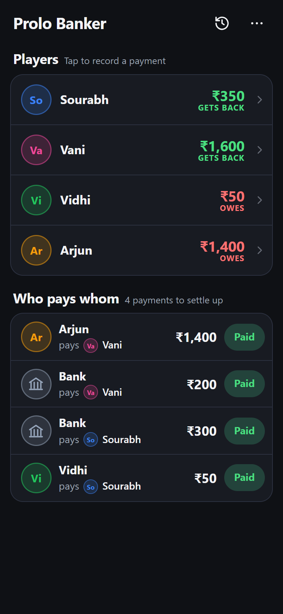
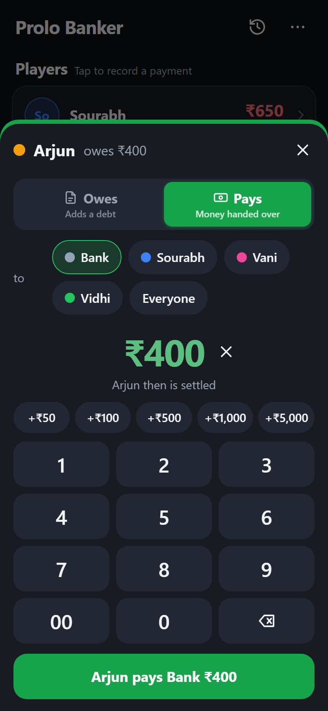
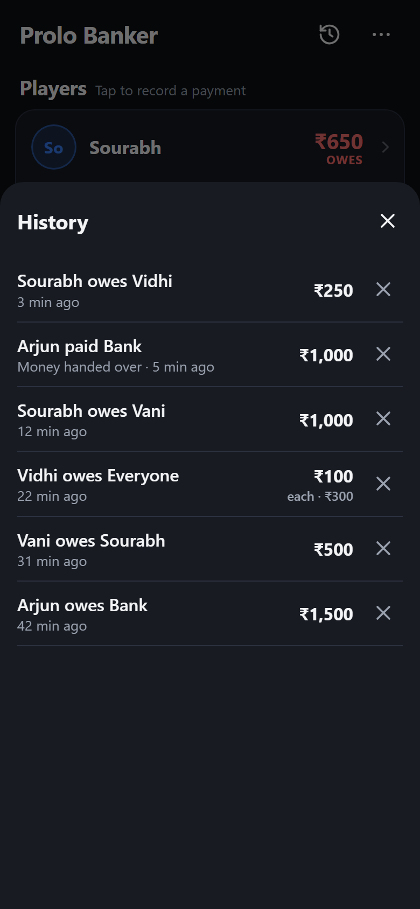
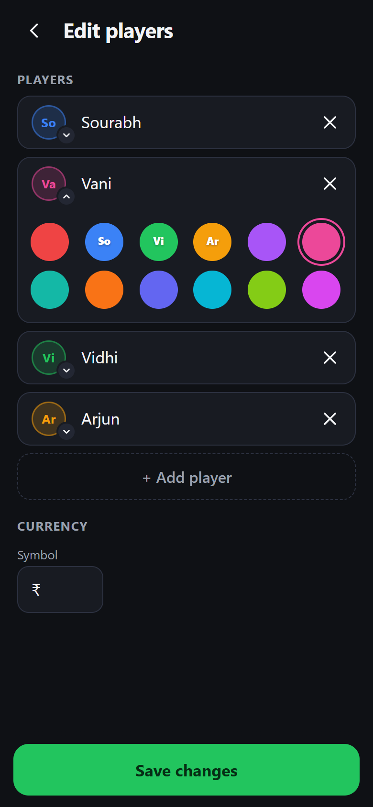
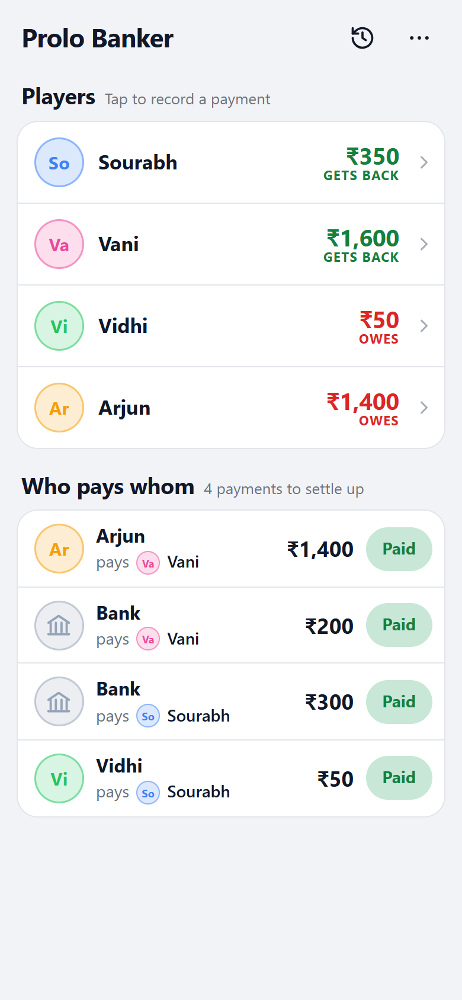

<p align="center">
  
</p>

<h1 align="center">Prolo Board Game Banker</h1>

<p align="center">
  <strong>Ditch the paper money.</strong> A free mobile banker app for Monopoly, Business, The Game of Life and any other board game with money.<br>
  Record who pays whom, see who owes how much, and settle up with the people you dealt with.
</p>

<p align="center">
  <a href="https://prolo-board-game-banker.slwrkr.workers.dev"><strong>▶ Open the app</strong></a>
  &nbsp;·&nbsp; Works offline &nbsp;·&nbsp; No sign-up &nbsp;·&nbsp; No ads
</p>

<p align="center">
  
  &nbsp;
  
  &nbsp;
  
</p>

## Why

In money-based board games, someone has to play banker, keep track of loans, rent and side deals, and remember who still owes what at the end. Prolo Board Game Banker does that on one phone. Every payment takes a few taps, and the app works out the shortest way for everyone to settle up.

## Features

- **Who pays whom.** Each person pays back the people they dealt with, including the Bank. Debts are never passed along to a third person; if two people paid each other, only the difference is paid. Tap **Paid** when the money changes hands.
- **Fast entry.** Tap a player, choose **Pays** or **Receives**, pick the Bank, another player or **Everyone**, and enter the amount on a big keypad or with +₹50 / +₹100 / +₹500 / +₹1,000 / +₹5,000 buttons.
- **Bank included.** The Bank is a party like any player and is selected by default.
- **Pay everyone at once.** "Vidhi pays everyone ₹100 each" is one entry.
- **Clear net position.** Each player shows how much they owe or get back overall.
- **Undo anything.** Every action has Undo, and History lets you delete any past entry. Totals are always recalculated from the full log, so they stay correct.
- **Rupees by default.** ₹ with Indian digit grouping (₹1,50,000). Change the symbol to $, €, £ or anything else.
- **Player colours.** Pick from 12 colours. Choosing a colour another player has swaps the two.
- **Made for the table.** Installable on iPhone and Android, works offline, keeps the screen awake during a game, and follows your phone's light or dark mode.
- **Private.** Everything is stored on your phone. Nothing is sent to a server, and there's no account or tracking.

<p align="center">
  
  &nbsp;
  
</p>

## Add it to your home screen

It installs like an app, with its own icon and full-screen view.

**iPhone / iPad (Safari)**
1. Open the app link in Safari.
2. Tap the **Share** button, then **Add to Home Screen**.
3. Tap **Add**. "Prolo Banker" appears on your home screen.

**Android (Chrome)**
1. Open the app link in Chrome.
2. Tap **⋮**, then **Add to Home screen** or **Install app**.

## How a game works

1. **Start a game.** Enter player names, or leave them blank for "Player 1", "Player 2" and so on. The last game's players are pre-filled for a rematch.
2. **Record payments as they happen.** For example, "Arjun pays Bank ₹1,500" or "Vani receives ₹2,000 from Bank". Nothing has to be paid on the spot; the app keeps a running tally.
3. **Settle up.** The **Who pays whom** list shows what each pair of people still owe each other. For example, if Vani owes Sourabh ₹200 and Sourabh owes Vidhi ₹200, it shows both payments: Vani pays Sourabh ₹200 and Sourabh pays Vidhi ₹200. If Sourabh also owes Vani ₹50, Vani pays Sourabh only ₹150.

## Self-host on Cloudflare Workers

The app is plain HTML, CSS and JavaScript with no build step. It's served as static assets by a Cloudflare Worker, which fits easily within the free plan.

```sh
git clone https://github.com/SHTO88/prolo-board-game-banker.git
cd prolo-board-game-banker
npm install
npm run dev        # http://localhost:8787
```

Deploy:

```sh
npx wrangler login # first time only
npm run deploy
```

After deploying changes, bump `CACHE` in `public/sw.js` so phones that installed the app pick up the new files.

### Project layout

```
public/
  index.html             App markup, iPhone and link-preview meta tags
  app.js                 All app logic (state, settlement, UI)
  styles.css             Styles, light and dark themes
  sw.js                  Service worker for offline use
  manifest.webmanifest   Install metadata (name, icons, colours)
  icon.svg               Source icon (rounded)
  icon-maskable.svg      Source icon (full-bleed, for iOS and Android masks)
  *.png                  Icons generated from the SVGs
docs/screenshots/        Images used in this README
wrangler.jsonc           Cloudflare Worker config (static assets only)
```

## Contributing

Issues and pull requests are welcome. Please keep the app dependency-free and fast on low-end phones.
